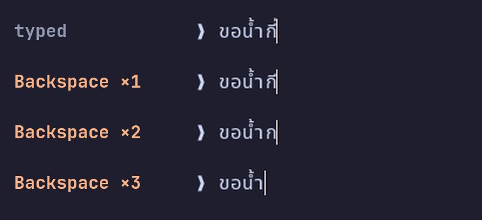
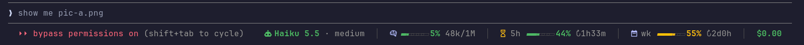
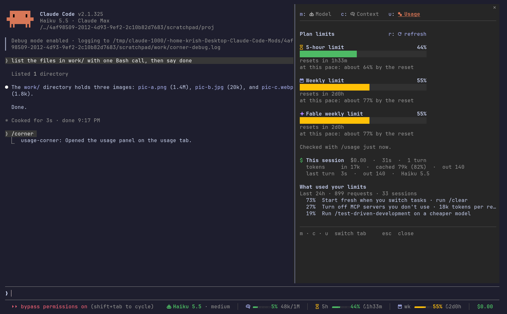
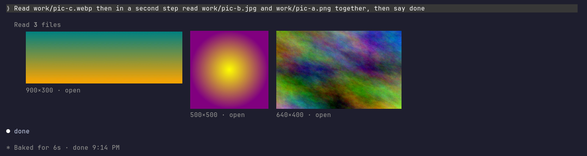
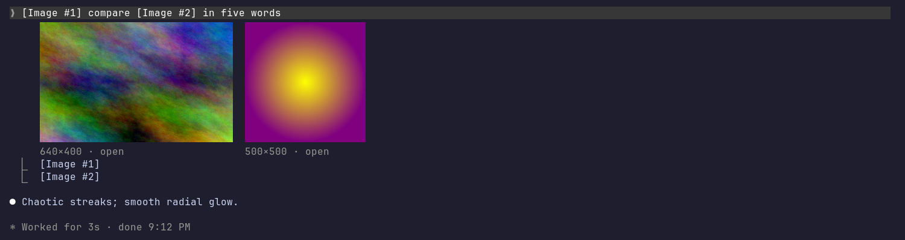

<div align="center">

# 🧩 Claude Code Mods by Krish

**Small mods that make the Claude Code terminal nicer to live in.**<br>
มอดเล็ก ๆ ที่ทำให้ Claude Code ในเทอร์มินัลใช้สบายขึ้น


[**thai-backspace**](#-thai-backspace) · [**usage-corner**](#-usage-corner) · [**image-preview**](#-image-preview) · [**keep-awake**](#-keep-awake) · [Install](#-install) · [Development](#-development)

</div>

---

## ⚡ Install

At the prompt of a Claude Code terminal session (answer `y` to add the marketplace, then pick a scope):

```text
/plugin install usage-corner --marketplace Kritsanai-Krish/claude-code-mods
/plugin install thai-backspace --marketplace Kritsanai-Krish/claude-code-mods
/plugin install image-preview --marketplace Kritsanai-Krish/claude-code-mods
/plugin install keep-awake --marketplace Kritsanai-Krish/claude-code-mods
```

From a shell instead:

```bash
claude plugin install usage-corner --marketplace Kritsanai-Krish/claude-code-mods
claude plugin install thai-backspace --marketplace Kritsanai-Krish/claude-code-mods
claude plugin install image-preview --marketplace Kritsanai-Krish/claude-code-mods
claude plugin install keep-awake --marketplace Kritsanai-Krish/claude-code-mods
```

In the desktop app (where `/plugin` does not run): click **+** next to the prompt box → **Plugins** → **Add marketplace** with `Kritsanai-Krish/claude-code-mods` → **Add plugin**.

Each mod is independent: install any of them.

---

## ⌫ thai-backspace

> **Backspace deletes one Thai mark at a time.** · ลบสระ/วรรณยุกต์ทีละตัว ไม่ลบทั้งพยางค์

Claude Code's prompt box treats a Thai consonant and the marks stacked on it as one character, so a single Backspace wipes the whole cluster. You meant to fix a tone mark and lost the consonant too.

With this mod, Backspace peels marks off one by one:



| You type | Backspace ① | Backspace ② | Backspace ③ |
| :---: | :---: | :---: | :---: |
| `กี่` | `กี` | `ก` | *(empty)* |
| `น้ำ` | `น้` | `น` | *(empty)* |
| `ก่อน` *(caret after ่)* | `กอน` | — | — |

- Works anywhere in the draft, not only at the end.
- Backspace, Shift+Backspace and Ctrl+H (the same key on some terminals) all peel one mark.
- Delete, Ctrl+Backspace, Alt+Backspace, Ctrl+W, other scripts and emoji behave exactly as before.
- Thai marks handled: ั ำ ิ ี ึ ื ุ ู ฺ ็ ่ ้ ๊ ๋ ์ ํ ๎ (U+0E31, U+0E33–0E3A, U+0E47–0E4E).
- Lao works the same way: `ກີ່` → `ກີ` → `ກ` (U+0EB1, U+0EB3–0EBC, U+0EC8–0ECE).

---

## 📊 usage-corner

> **Model, effort, context, plan limits and cost at the bottom right, updated as things happen.**<br>
> โมเดล · effort · context · limit · ค่าใช้จ่าย ที่มุมขวาล่าง อัปเดตทันที กดดูรายละเอียดได้

```text
󰚩 Opus 5.5 · high  │  󰧑 ▰▱▱▱▱ 16% 158k/1M  │  󰔟 5h ▰▱▱▱▱ 7% ↻3h58m  │  󰨳 wk ▰▰▰▱▱ 50% ↻2d3h  │  󰇁5.54
```



### What the corner shows

| Part | Meaning |
| --- | --- |
| 󰚩 **Model** | The model in use, colored by family (Opus orange, Sonnet blue, Haiku green, Fable purple), then the effort level. If a fallback model answered the last turn, it is named: `Fable 5.2 → Opus 5.5` |
| 󰧑 **Context** | How full the context window is, with tokens used / window size. A `~` marks a local estimate: a new, cleared or just-compacted session has no API count until the next reply |
| 󰔟 **5h** | Your 5-hour plan limit and the time until it resets |
| 󰨳 **wk** | Your weekly plan limit (all models) |
| 󰫢 **Fable** | Fable's own weekly limit, shown only while you are on Fable |
| 󰇁 **Cost** | What this session has cost, in USD |

Meters turn **green → yellow → red** at 50% and 80%. On a narrow terminal the corner sheds detail step by step (spacing, token counts, reset times, effort, meters, the model version, cost) so the percentages always fit beside the hint line.

### When it updates

| What happens | When the corner follows |
| --- | --- |
| `/model`, the model picker, the `/config` model row, fast mode, an automatic fallback | At once |
| `/effort <level>` | At once. An effort picked for this session only shows with the next reply |
| A long turn with many tool calls | After every batch of tool results, so context and cost move while Claude works |
| A turn ends, a subagent finishes | At once |
| `/compact` or an automatic compaction | Within 5 seconds, as an estimate |
| `/clear`, `/resume` | At once; the session totals start over |
| A reset time passes while you are idle | The old percentage is dropped and `/usage` is asked for the new one |
| Another session spends your limits | Within the background check (3 minutes by default) |
| Anything else | A check every 5 seconds picks it up; countdowns tick every minute |

### Click for details

Every part of the corner is a button. Clicking one opens a panel docked beside the chat. It never covers your work, and **Esc**, **✕** or a second click closes it. Without a mouse, type `/corner`, `/corner model`, `/corner context` or `/corner usage`; `/corner refresh` re-reads the limits.



| Tab | Key | What you get |
| --- | :---: | --- |
| 󰚩 **Model** | `m` | Opus / Fable / Sonnet / Haiku with the current one marked; press `1`–`4` or click to switch. Below it, the effort levels: click one to set it |
| 󰧑 **Context** | `c` | The colored grid and per-category token table, as `/context` shows it, the largest items (MCP servers, memory files, the skill list), and how far the auto-compact point is. `r` re-counts |
| 󰇞 **Usage** | `u` | A meter for every plan limit with its reset time and where the current pace leads (`at this pace: used up in 47m, before the reset`), this session's cost, duration, turns and tokens with the share read from cache, the last turn, and *what used your limits* in the last 24 h. `r` refreshes |

### Heads-up alerts

A toast appears when any limit first reaches **80%**, and again at **95%**:

```text
⚠ 5-hour limit at 82% · resets in 1h20m
```

Each level warns once per reset period, even across new sessions. When a limit you were warned about resets, a second toast says so (`✓ 5-hour limit has reset`). The context window warns the same way at 80% and 90% full.

### Settings

The mod adds four rows to `/config`:

| Row | Values | Default |
| --- | --- | --- |
| Icons | `nerd` (Nerd Font icons) or `unicode` (plain symbols every font has) | `nerd` |
| Limit and context warnings | on / off | on |
| Show session cost | on / off | on |
| Background limit check | `off`, `1 min`, `3 min`, `5 min`, `10 min` | `3 min` |

### Requirements

- **A Nerd Font** in your terminal for the icons (for example *JetBrainsMono Nerd Font*), or set Icons to `unicode`.
- **Fullscreen layout** for mouse clicks: set `"tui": "fullscreen"` in `~/.claude/settings.json`. `/corner` works in either layout.
- **A Claude subscription** for the 5h / weekly / Fable limits. With an API key the corner shows model, context and cost only.

### How it reads the limits

Claude Code hands mods the 5-hour and weekly figures from the last reply's headers. They go stale while a session is idle and do not include a model's own weekly window. The claude.ai usage endpoint has every window as of now, and `claude -p /usage` prints it. The mod runs that in the background with `--no-session-persistence --setting-sources ""`: it calls no model, uses no tokens, saves no session and loads none of your plugins, so it never re-runs itself. Open sessions share one reading, so ten sessions do not mean ten runs. Per window, the newer of the two sources is shown. If a future Claude Code changes the wording of `/usage`, the Fable meter disappears and the rest keeps working.

A headless run (`claude -p`) starts no timer and no `/usage` run.

---

## 🖼 image-preview

> **See the picture, not just `[Image #1]`.** · ดูรูปในแชทได้เลย ทั้งรูปที่เราแนบและรูปที่ tool ส่งกลับมา

Claude Code sends images to the model but shows you only a placeholder. This mod draws them in the transcript:



| What | Where it appears |
| --- | --- |
| An image you paste, drag in, or drop as a file path | Under your message |
| An image Claude opens with **Read** | Under the `Read(...)` row, or under the folded `Read 3 files` line |
| An image any other tool returns: a browser or desktop screenshot, an MCP server's result | Under that tool's row |

- You see the same picture Claude sees (Claude Code's own resized copy).
- One picture is drawn large; several on one row become thumbnails side by side and wrap when the window is narrow. Small icons stay small.
- Under each picture: its size in pixels and **open**, which shows it in your desktop's image viewer.
- A picture is tied to its message by the message's id, so sending the same words twice never shows the wrong picture.
- Other surfaces (desktop app, VS Code) are left alone; they have their own previews.

Pasted images appear right under your message:



### Settings

| `/config` row | Values | Default |
| --- | --- | --- |
| Picture size | `small`, `medium`, `large` | `medium` (at most 72 columns × 20 rows; thumbnails 40 × 10) |
| Captions | on / off | on |

### Requirements

- **A terminal with the kitty graphics protocol**: Ghostty, kitty, or iTerm2 3.5+. Elsewhere you get a dim `[image 640×480]` line instead.
- **ImageMagick** for JPEG, GIF and WebP (`magick`, or `convert` from ImageMagick 6). PNG needs nothing. Without ImageMagick the row says so instead of failing silently. Fedora: `sudo dnf install ImageMagick` · Debian/Ubuntu: `sudo apt install imagemagick` · macOS: `brew install imagemagick`.

Pictures up to 2 MiB are sent to the terminal as bytes, so previews also work when Claude Code runs on another machine over ssh.

### Where previews are kept

PNGs go to `~/.cache/claude-image-preview/` (or under `$XDG_CACHE_HOME`; folder mode 700) and are deleted after 7 days. Clearing the folder is always safe.

---

## ☕ keep-awake

> **The screen stays on while Claude Code is open.** · เปิด Claude ไว้ จอไม่ดับ เครื่องไม่สลีป

Leave Claude Code working on a long task and come back to a dark screen, or worse, a suspended machine that stopped the task. With this mod the screen stays on and the computer stays out of idle sleep for as long as a Claude Code session is open. Close the session and your normal power settings apply again.

| Command | What it does |
| --- | --- |
| `/keep-awake` | Turns it off for this session, or back on |
| `/keep-awake on` · `/keep-awake off` | Sets it directly |
| `/keep-awake status` | Says whether it is on and which method holds the screen |

### How each system is kept awake

Nothing to install: each method uses what the system already has.

| System | Method |
| --- | --- |
| Windows 10 / 11 | `SetThreadExecutionState` (display + system required) from the built-in Windows PowerShell; PowerShell 7 if that is missing |
| macOS | `caffeinate -d -i -w <Claude Code's pid>` |
| WSL | Resets Windows' display and sleep idle timers every 30 seconds through `powershell.exe` |
| Linux and BSD | Starts every method the machine has and keeps the ones that take: GNOME (`gnome-session-inhibit`), KDE (`kde-inhibit`), logind (`systemd-inhibit --what=idle`, which hypridle and other idle daemons follow) and the freedesktop `ScreenSaver` / `PowerManagement` D-Bus inhibit (KDE, XFCE, MATE, Cinnamon, LXQt) |
| X11 with none of the above | `xdg-screensaver reset` (or `xset s reset`) every 30 seconds |

If a system has none of these (a bare Wayland compositor with no idle daemon, for example), a toast says so and `/keep-awake status` names the platform.

### What it does not block

Locking the screen yourself, closing a laptop lid and choosing Suspend or Shut Down all work as usual. The mod only stops the *idle* timers.

### Nothing left behind

Every helper the mod starts watches Claude Code and quits within 5 seconds of it closing, even after a crash or `kill -9`. On Windows and macOS the system drops the request when the helper ends.

---

## 🛠 Development

```bash
git clone https://github.com/Kritsanai-Krish/claude-code-mods
cd claude-code-mods

claude plugin validate .                # manifests + hooks modules
claude plugin test ./usage-corner       # 81 tests
claude plugin test ./thai-backspace     # 13 tests
claude plugin test ./image-preview      # 27 tests
claude plugin test ./keep-awake         # 4 tests

claude --plugin-dir ./usage-corner      # run a session with your working copy
```

```text
claude-code-mods/
├── .claude-plugin/marketplace.json
├── docs/screenshots/    README images (real Ghostty screenshots)
├── thai-backspace/
│   └── hooks/            register.ts · thai-marks.ts (+ tests)
├── keep-awake/
│   └── hooks/            register.ts · plans.ts · posix-script.ts · windows-script.ts (+ tests)
├── image-preview/
│   ├── hooks/            register.tsx · blocks.ts · convert.ts · image-size.ts
│   │                     options.ts · state.ts (+ tests)
│   └── types/index.d.ts  state contract
└── usage-corner/
    ├── hooks/            register.tsx   which event refreshes what, and the drawing
    │                     state.ts       everything stored for the session
    │                     snapshot.ts · limits.ts · plan-usage.ts · reset-time.ts
    │                     alerts.ts · activity.ts · options.ts
    │                     format.ts      the corner · panel.tsx, panel-format.ts  the panel
    │                     (+ tests)
    └── types/index.d.ts  state contract
```

Mods use the Claude Code function-hooks API (early access), which may change between releases. Built and tested on Claude Code 2.1.325.

---

<div align="center">

MIT © [Krish](https://github.com/Kritsanai-Krish)

</div>
