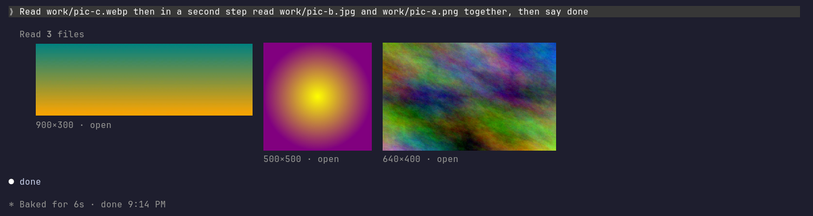

# 🖼 image-preview

Shows pictures right in Claude Code's transcript: images you paste or drop into the prompt appear under your message, and images a tool returns (Read, a screenshot tool, an MCP server) appear under that tool's row. Several pictures are drawn side by side, each with its size and an **open** button.

```text
/plugin install image-preview --marketplace Kritsanai-Krish/claude-code-mods
```



Needs a terminal with the kitty graphics protocol (Ghostty, kitty, or iTerm2 3.5+), and ImageMagick for JPEG, GIF and WebP; PNG needs nothing. Full guide: see the [main README](../README.md#-image-preview).

MIT © Krish
