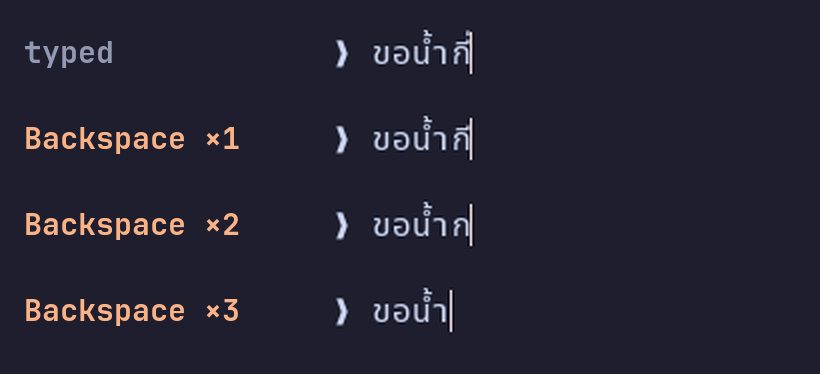

# ⌫ thai-backspace

Backspace in Claude Code's prompt box deletes **one Thai vowel or tone mark at a time** (`กี่` → `กี` → `ก`) instead of the whole consonant cluster.

```text
/plugin install thai-backspace --marketplace Kritsanai-Krish/claude-code-mods
```



Details, examples and the list of marks: see the [main README](../README.md#-thai-backspace).

MIT © Krish
