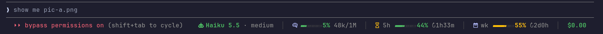

# 📊 usage-corner

Model, effort, context window, 5-hour / weekly limits (plus Fable's own weekly limit while on Fable) and session cost at the bottom right of Claude Code's prompt, updated as things happen: a model switch, each batch of tool calls in a long turn, a compaction, a limit resetting while you are idle. Click any part, or type `/corner`, for a panel with a model and effort switcher, a context breakdown and detailed usage. Toasts warn at 80% and 95%.

```text
󰚩 Opus 5.5 · high  │  󰧑 ▰▱▱▱▱ 16% 158k/1M  │  󰔟 5h ▰▱▱▱▱ 7% ↻3h58m  │  󰨳 wk ▰▰▰▱▱ 50% ↻2d3h  │  󰇁5.54
```



```text
/plugin install usage-corner --marketplace Kritsanai-Krish/claude-code-mods
```

Needs a Nerd Font for the icons (or set Icons to `unicode` in `/config`) and `"tui": "fullscreen"` for clicks. Full guide: see the [main README](../README.md#-usage-corner).

MIT © Krish
